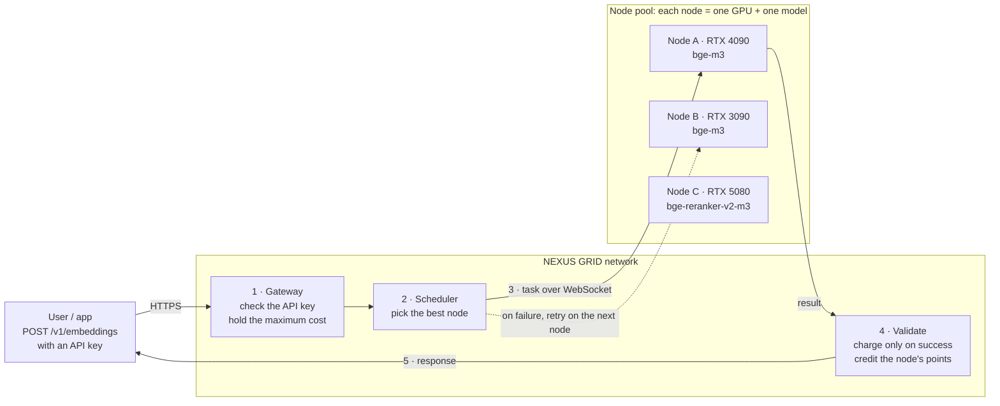
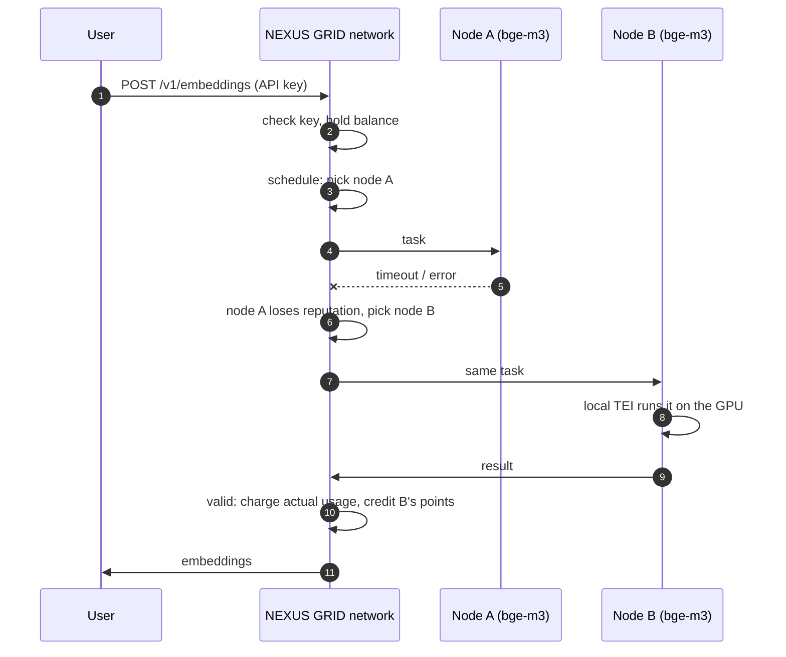
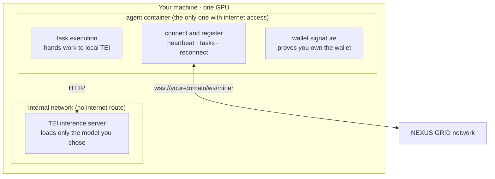

# NEXUS GRID Miner

[中文](README.md) | **English**

[](https://github.com/0xRouteAI/nexus-grid-miner/actions/workflows/ci.yml)


## What is NEXUS GRID

NEXUS GRID is an **open, decentralized AI inference network**.

- **For developers**: call open-source models through one OpenAI-compatible API, pay per use, and **pay nothing for failed requests**.
- **For GPU owners**: anyone can connect an NVIDIA GPU to the network as a **node**, serve real requests and earn points for every completed task. No approval, no contract; join and leave whenever you like.

**This repository is the node software**: a small Go program (the agent) plus Hugging Face's official
[text-embeddings-inference](https://github.com/huggingface/text-embeddings-inference) (TEI) server.

**One GPU serves one model.** Currently available:

| Model | Use | VRAM |
|---|---|---|
| [`bge-m3`](https://huggingface.co/BAAI/bge-m3) | text embeddings for search and RAG | 8 GB+ |
| [`bge-reranker-v2-m3`](https://huggingface.co/BAAI/bge-reranker-v2-m3) | reranking: scores and orders retrieved results | 8 GB+ |

More models will follow. When the network publishes a new version, nodes discover it and switch automatically, with no reinstall.

---

## Architecture: how a request reaches your GPU



**1 · Gateway**: the network checks the user's API key and holds the maximum possible cost of the request from their balance.

**2 · Scheduler**: it picks a node from the pool:

1. **Filter**: only nodes that are online, not banned, serving **this exact model version**, with enough VRAM and spare capacity. A node running `bge-m3` never receives rerank requests, and vice versa.
2. **Rank**: fewest tasks in flight first, then highest reputation, then most completed tasks.

**3 · Task**: the task travels over the WebSocket **the node opened itself**, so nodes need no public IP and no open port. The node hands it to its local TEI, computes it on the GPU and sends the result back.

**4 · Validate**: the network checks the result's shape (vector count, dimensions, score ranges and so on). Only then is the actual usage charged, the rest of the hold is returned to the user, and the node that did the work earns points.

**5 · Response**: the result goes back to the user.

**When something fails**: if a node times out, errors or returns an invalid result, the network **retries on a node of a different wallet**, up to 3 attempts per request. If every attempt fails, the whole hold is returned and the user pays nothing. Failing nodes lose reputation, and low-reputation nodes get less work.

### Timeline of one request



### Inside a node



- **Outbound only**: the agent dials out; your machine exposes no port.
- **Inference is offline**: TEI sits on a network with no route to the internet, so it cannot quietly forward requests to another AI service and pretend to compute. The network also spot-checks results, and cheating wallets are banned as a whole.
- **The wallet only signs**: the private key signs a registration message on each connect to prove the wallet is yours. It never sends a transaction and needs no funds. Use a new EVM wallet.

---

## Run a node

### Prerequisites

- An NVIDIA GPU: RTX 20 series or newer, 8 GB+ VRAM.
- NVIDIA drivers (CUDA 12.2 or newer) and the [NVIDIA Container Toolkit](https://docs.nvidia.com/datacenter/cloud-native/container-toolkit/latest/install-guide.html).
- Docker and Docker Compose v2.
- A **new, dedicated EVM wallet** (see [About the wallet](#about-the-wallet)).
- The network's domain, e.g. `nexus.example.com`.

### About the wallet

A node needs an **EVM wallet**: an Ethereum-style address starting with `0x`. Any EVM wallet works (MetaMask, Rabby, OKX Wallet, ...).

- **The private key is only used for signing**: on every connect the node signs a registration message to prove the wallet is yours. **It never sends a transaction, never touches any assets, and the wallet needs no funds**; no chain needs to be selected.
- **Create a new wallet for this**: add a new account in your wallet app and export its private key into `.env`. **Never use a wallet that holds assets**: the key is stored in plain text on this machine.
- **Points are tied to this address**: log in to the miner dashboard with the same wallet to see your nodes, tasks and points.
- **Protect `.env`**: never upload, screenshot or share it. On Linux run `chmod 600 .env` so only you can read it.

### 1. Download and configure

```bash
git clone https://github.com/0xRouteAI/nexus-grid-miner.git
cd nexus-grid-miner
cp .env.example .env
```

Edit `.env` and fill in five values (keep comments on their own lines, never after a value):

```dotenv
SERVER_URL=nexus.example.com
WALLET=0xYourWalletAddress
MINER_PRIVATE_KEY=your_private_key
COMPOSE_PROFILES=bge-m3
TEI_IMAGE=ghcr.io/huggingface/text-embeddings-inference:89-1.10
```

| Value | Meaning |
|---|---|
| `SERVER_URL` | the network's domain is enough |
| `WALLET` | the new EVM wallet address (starts with `0x`); points are credited here |
| `MINER_PRIVATE_KEY` | that wallet's private key, **used only for signing**, never for transactions; never commit or share it |
| `COMPOSE_PROFILES` | **the one model this GPU serves**: `bge-m3` or `bge-reranker-v2-m3` |
| `TEI_IMAGE` | **must match your GPU**, see the table |

| GPU | `TEI_IMAGE` |
|---|---|
| RTX 20 series / T4 | `ghcr.io/huggingface/text-embeddings-inference:turing-1.10` |
| RTX 30 series / A10 / A40 | `ghcr.io/huggingface/text-embeddings-inference:86-1.10` |
| RTX 40 series / L4 / L40 | `ghcr.io/huggingface/text-embeddings-inference:89-1.10` |
| RTX 50 series | `ghcr.io/huggingface/text-embeddings-inference:120-1.10` |
| A100 / A30 | `ghcr.io/huggingface/text-embeddings-inference:1.10` |
| H100 | `ghcr.io/huggingface/text-embeddings-inference:hopper-1.10` |

Also give the node a name, e.g. `NODE_ID=home-4090`.

### 2. Download the model (once)

The inference container has no internet access while serving, so download the model first with the bootstrap configuration:

```bash
docker compose -f docker-compose.yml -f docker-compose.bootstrap.yml up -d
docker compose -f docker-compose.yml -f docker-compose.bootstrap.yml logs -f
docker compose -f docker-compose.yml -f docker-compose.bootstrap.yml down
```

The second command keeps printing logs; press Ctrl+C once it shows `Ready`, then run the third. The model stays in a Docker volume and is never downloaded again.

### 3. Start the node

```bash
docker compose up -d --build
docker compose logs -f agent
```

`miner registered with server` means the node is online and taking tasks.

### Several GPUs in one machine

Run one node per GPU: copy this folder and change three values in the copy's `.env`:

```dotenv
GPU_DEVICE=1
NODE_ID=home-gpu1
COMPOSE_PROFILES=bge-reranker-v2-m3
```

- `GPU_DEVICE` is the GPU's index in `nvidia-smi`.
- Each GPU can serve a different model.
- The same wallet can be used everywhere; all points go to it.
- Model files are shared by every node on the machine and downloaded once.

### Without Docker

You can build a single binary (Go 1.24+) and run TEI yourself:

```bash
cd agent-go
go build -trimpath -o bin/nexus-miner-agent ./cmd/agent
SERVER_URL=nexus.example.com WALLET=0x... MINER_PRIVATE_KEY=... MODEL=bge-m3 \
  TEI_URL=http://127.0.0.1:8080 ./bin/nexus-miner-agent
```

For the reranker, set `MODEL=bge-reranker-v2-m3` and use `RERANK_URL` instead of `TEI_URL`.
For Windows see [`RUN_WINDOWS.md`](RUN_WINDOWS.md) (Chinese).

---

## What the node handles by itself

- **Disconnects**: reconnects automatically, starting at 1 second and backing off to at most 30 seconds.
- **Model updates**: reads the network's model catalog periodically and re-registers for a new version without a restart.
- **Inference server down**: checked every 30 seconds. While TEI is down the node takes no work; it comes back online when TEI recovers.
- **Rejected by the network**: for example a retired version. The node refreshes the catalog and retries instead of crash-looping.
- **Shut down any time**: `docker compose down` or power off. Unfinished tasks are moved to other nodes.

---

## Troubleshooting

| Log line | Cause / fix |
|---|---|
| `SERVER_URL is required` / `WALLET is required` / `MINER_PRIVATE_KEY is required` | that value is missing from `.env` |
| `Set COMPOSE_PROFILES in .env` / `MODEL is required` | no model chosen for this GPU |
| `MODEL must name exactly one model` | one GPU serves one model; put a single model in `COMPOSE_PROFILES` |
| `Set TEI_IMAGE in .env for your GPU` | `TEI_IMAGE` is missing; pick one from the table |
| `compute cap` / `CUDA` errors in the inference container logs | `TEI_IMAGE` does not match the GPU, or the driver is too old |
| `MINER_PRIVATE_KEY belongs to ..., not WALLET ...` | the key and the wallet address are different accounts |
| `connection refused` / timeout | wrong `SERVER_URL`, a firewall, or a proxy that does not forward WebSockets |
| `no servable model yet; retrying` | TEI is still loading; wait for `Ready` |
| `model identity check failed` | TEI loaded a different model than the network expects |
| signature errors | the clock is off by more than 5 minutes; enable automatic time sync |
| `Unknown GPU` | install the NVIDIA Container Toolkit, or set `GPU_MODEL` / `VRAM_MB` in `.env` |
| `wallet is banned` | failed audits or repeated failures; contact the network operator to appeal |

Every interface, setting and automatic behavior is described in [`docs/INTERFACES.md`](docs/INTERFACES.md) (Chinese; JSON examples are language-neutral).

---

## Development

```bash
cd agent-go
go vet ./...
go test -race ./...
```

| Path | Responsibility |
|---|---|
| `agent-go/cmd/agent` | entry point: connect and reconnect with backoff; the supervisor keeps the servable model and re-registers when the catalog or health changes |
| `agent-go/internal/wsclient` | WebSocket session: register, heartbeat, concurrent tasks, cancel in-flight work on disconnect |
| `agent-go/internal/engine` | hands tasks to local TEI; verifies at startup which model TEI loaded |
| `agent-go/internal/catalogclient` | reads the network's model catalog and decides which version this GPU can serve |
| `agent-go/internal/signing` | wallet signature (EIP-191) |
| `agent-go/internal/gpu` | detects GPU model and VRAM |
| `agent-go/internal/protocol` | message formats exchanged with the network |
| `agent-go/internal/teitest` | TEI stand-in for tests |

Issues and pull requests are welcome. Before changing the wire format, read section F of [`docs/INTERFACES.md`](docs/INTERFACES.md).
**Never paste private keys or `.env` files into issues, logs or commits.**

## Security

Please report security issues privately to the maintainers instead of opening a public issue.

## License

[MIT](LICENSE)
