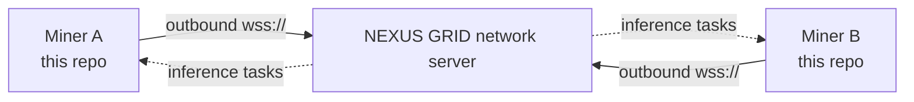
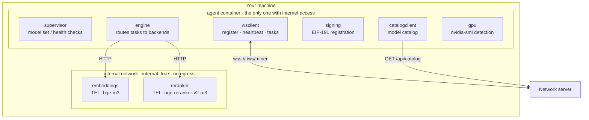
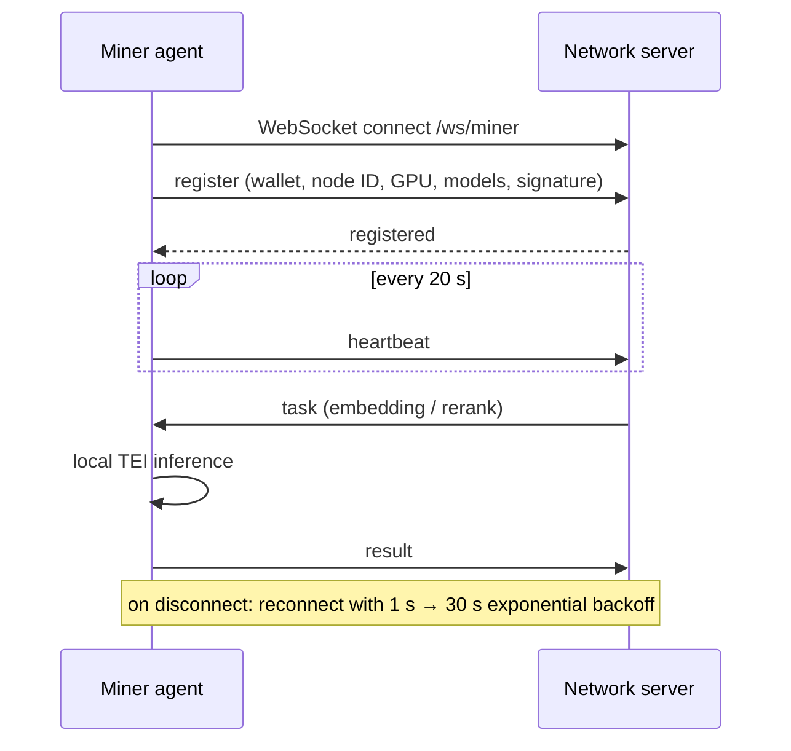

# NEXUS GRID Miner

[中文](README.md) | **English**

**Plug your GPU into the NEXUS GRID decentralized AI inference network, serve real requests and earn points.**

[](https://github.com/0xRouteAI/nexus-grid-miner/actions/workflows/ci.yml)


NEXUS GRID is an open AI inference network whose work is done by GPU nodes.
**This repository is the node side (the miner):** a small Go agent plus the official Hugging Face
[text-embeddings-inference](https://github.com/huggingface/text-embeddings-inference) (TEI) containers.

- **No public IP, no open ports.** The miner dials out over WebSocket; the server never connects in.
- **Join and leave at any time.** The agent reconnects on its own; in-flight work fails over to other nodes at no cost to you.
- **Points for successful work.** Points go to your wallet address; one wallet can run many GPUs and machines.
- **The wallet only signs.** The private key signs the registration message (EIP-191). It never sends a transaction and needs no funds.

Supported models:

| Model | Capability | Recommended VRAM |
|---|---|---|
| [`BAAI/bge-m3`](https://huggingface.co/BAAI/bge-m3) | text embedding | 8 GB+ |
| [`BAAI/bge-reranker-v2-m3`](https://huggingface.co/BAAI/bge-reranker-v2-m3) | rerank | 16 GB to run both |

More models will follow; when the network publishes one, the agent discovers and advertises it automatically.

---

## Architecture

### How a miner connects



You only configure the network's domain (e.g. `nexus.example.com`); the agent connects to
`wss://nexus.example.com/ws/miner`. The miner does one thing:
**receive a task → compute it on the local GPU → send the result back.**

### Inside one miner host



The inference containers sit on an internal network with **no route to the internet**; only the agent
can reach outside. That makes it hard to forward requests to an external API and pretend to compute.
The network also spot-checks results, and cheating wallets are banned as a whole.

### Code layout

| Path | Responsibility |
|---|---|
| `agent-go/cmd/agent` | Entry point. The main loop connects and reconnects with backoff; the `supervisor` keeps the set of servable models and re-registers when the catalog or backend health changes |
| `agent-go/internal/wsclient` | WebSocket session: register, heartbeat, concurrent tasks, cancel in-flight work on disconnect |
| `agent-go/internal/engine` | Routes each task to its TEI backend; verifies at startup that TEI `/info` reports the expected model |
| `agent-go/internal/catalogclient` | Fetches the model catalog (versions, VRAM requirements) and decides what this GPU can serve |
| `agent-go/internal/signing` | EIP-191 signature over the registration challenge |
| `agent-go/internal/gpu` | Detects GPU model and VRAM (`nvidia-smi`, or set manually) |
| `agent-go/internal/protocol` | Message types exchanged with the network server; see [`docs/INTERFACES.md`](docs/INTERFACES.md) |
| `agent-go/internal/teitest` | TEI stand-in for tests |
| `docker-compose.yml` | Agent + two TEI containers; `docker-compose.bootstrap.yml` is only for the first model download |

### One session



---

## Getting started

### Prerequisites

- An NVIDIA GPU (RTX 20 series or newer, 8 GB+ VRAM) with drivers (CUDA 12.2+) and the
  [NVIDIA Container Toolkit](https://docs.nvidia.com/datacenter/cloud-native/container-toolkit/latest/install-guide.html)
- Docker and Docker Compose v2
- A **dedicated** wallet address and its private key (used only for signing, needs no balance; do not use a wallet that holds funds)
- The network's domain, e.g. `nexus.example.com`

### 1. Clone and configure

```bash
git clone https://github.com/0xRouteAI/nexus-grid-miner.git nexus-grid-miner
cd nexus-grid-miner
cp .env.example .env
```

Edit `.env` and fill in four values (keep comments on their own lines, never after a value):

```dotenv
SERVER_URL=nexus.example.com
WALLET=0xYourWalletAddress
MINER_PRIVATE_KEY=your_private_key
TEI_IMAGE=ghcr.io/huggingface/text-embeddings-inference:89-1.10
```

- `SERVER_URL`: the network's domain is enough.
- `WALLET`: points are credited to this address.
- `MINER_PRIVATE_KEY`: registration signing only; never commit or share it.
- `TEI_IMAGE`: **must match your GPU**, otherwise the inference containers will not start:

| GPU | `TEI_IMAGE` |
|---|---|
| RTX 20 series / T4 | `ghcr.io/huggingface/text-embeddings-inference:turing-1.10` |
| RTX 30 series / A10 / A40 | `ghcr.io/huggingface/text-embeddings-inference:86-1.10` |
| RTX 40 series / L4 / L40 | `ghcr.io/huggingface/text-embeddings-inference:89-1.10` |
| RTX 50 series | `ghcr.io/huggingface/text-embeddings-inference:120-1.10` |
| A100 / A30 | `ghcr.io/huggingface/text-embeddings-inference:1.10` |
| H100 | `ghcr.io/huggingface/text-embeddings-inference:hopper-1.10` |

Also give the machine a name, e.g. `NODE_ID=home-4090`.

**8 GB cards**: delete `COMPOSE_PROFILES=rerank` from `.env` and set `ENABLED_MODELS=bge-m3` to serve the embedding model only.

### 2. Download model weights (once)

The inference containers have no internet access at runtime, so download the weights first
with the bootstrap configuration:

```bash
docker compose -f docker-compose.yml -f docker-compose.bootstrap.yml up -d embeddings reranker
docker compose -f docker-compose.yml -f docker-compose.bootstrap.yml logs -f embeddings reranker
docker compose -f docker-compose.yml -f docker-compose.bootstrap.yml stop
```

The second command keeps printing logs; press Ctrl+C once both services report `Ready`. On an 8 GB card, drop `reranker` from all three commands.

### 3. Start the miner

```bash
docker compose up -d --build
docker compose logs -f agent
```

`miner registered with server` means the node is online and taking tasks.

> Several GPUs or machines: use the same `WALLET` and a different `NODE_ID` on each node; all points go to one wallet.

### Native Windows / build from source

To run without Docker, build a single binary (Go 1.24+):

```bash
cd agent-go
go build -trimpath -o bin/nexus-miner-agent ./cmd/agent
SERVER_URL=nexus.example.com WALLET=0x... MINER_PRIVATE_KEY=... \
  TEI_URL=http://127.0.0.1:8080 RERANK_URL=http://127.0.0.1:8081 ./bin/nexus-miner-agent
```

You then run the TEI servers yourself. For the Windows helper scripts (`start.ps1` / `stop.ps1`)
see [`RUN_WINDOWS.md`](RUN_WINDOWS.md) (Chinese).

---

## Troubleshooting

| Log line | Cause / fix |
|---|---|
| `SERVER_URL is required` / `WALLET is required` / `MINER_PRIVATE_KEY is required` | That value is missing from `.env` |
| `MINER_PRIVATE_KEY belongs to ..., not WALLET ...` | The key and the wallet address are different accounts |
| `Set TEI_IMAGE in .env for your GPU` | `TEI_IMAGE` is missing from `.env`; pick one from the table above |
| `compute cap` / `CUDA` errors in the inference container logs | `TEI_IMAGE` does not match the GPU, or the driver is too old (CUDA 12.2+ required) |
| `connection refused` / timeout | Wrong `SERVER_URL`, a firewall, or a proxy that does not forward WebSocket upgrades |
| `no servable model yet; retrying` | TEI is still loading, or no enabled model fits this GPU's VRAM |
| `model identity check failed` | TEI loaded a different checkpoint; check `TEI_MODEL_ID` / `RERANK_MODEL_ID` |
| signature errors | The clock is off by more than 5 minutes; enable automatic time sync |
| `Unknown GPU` | Install the NVIDIA Container Toolkit, or set `GPU_MODEL` / `VRAM_MB` in `.env` |
| `wallet is banned` | Failed audits or repeated failures; contact the network operator to appeal |

Every interface, setting and automatic behavior is described in [`docs/INTERFACES.md`](docs/INTERFACES.md) (Chinese; JSON examples are language-neutral).

---

## Development

```bash
cd agent-go
go vet ./...
go test -race ./...
```

Issues and pull requests are welcome. Before changing the wire format, read section F of
[`docs/INTERFACES.md`](docs/INTERFACES.md). **Never paste private keys or `.env` files into issues, logs or commits.**

## Security

Please report security issues privately to the maintainers instead of opening a public issue.

## License

[MIT](LICENSE)
