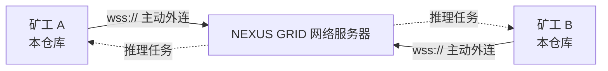
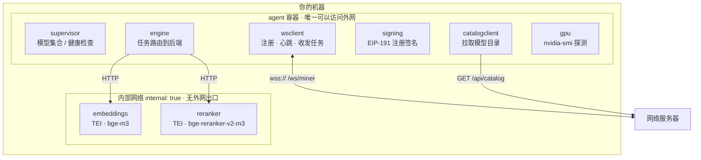
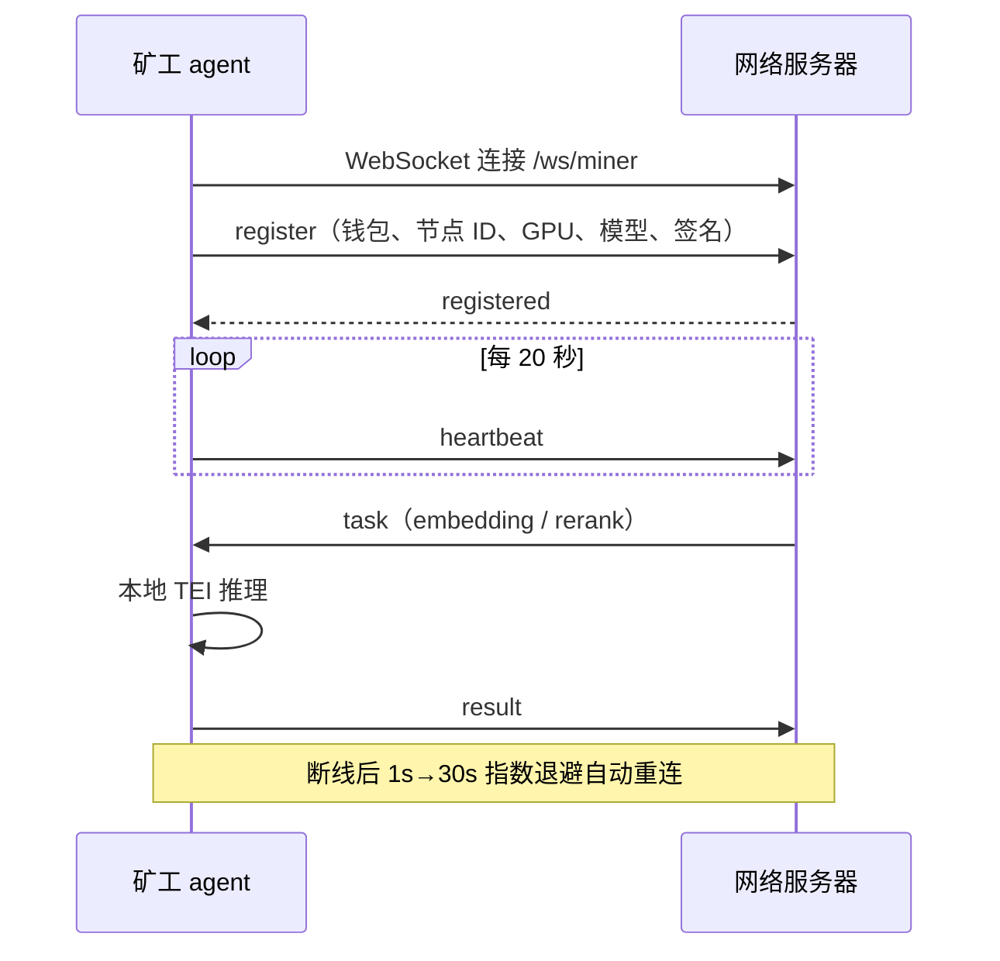

# NEXUS GRID Miner

**中文** | [English](README.en.md)

**把你的 GPU 接入 NEXUS GRID 去中心化 AI 推理网络，为真实请求做推理，赚取积分。**

[](https://github.com/0xRouteAI/nexus-grid-miner/actions/workflows/ci.yml)


NEXUS GRID 是一个开放的 AI 推理网络，推理任务由网络里的 GPU 节点完成。
**本仓库就是节点端（矿工端）**：一个小巧的 Go 程序，加上官方的 Hugging Face
[text-embeddings-inference](https://github.com/huggingface/text-embeddings-inference)（TEI）推理容器。

- **不需要公网 IP，不需要开放端口**：矿工主动向外连 WebSocket，服务器从不反向连你。
- **随时加入、随时离开**：断线自动重连，在途任务由网络转给其他节点，不扣你任何东西。
- **按成功的任务记积分**：积分记到你的钱包地址；一个钱包可以挂多台机器、多张卡。
- **钱包只用来签名**：私钥只对注册消息做 EIP-191 签名，不发交易，不需要钱包里有钱。

当前支持的模型：

| 模型 | 能力 | 建议显存 |
|---|---|---|
| [`BAAI/bge-m3`](https://huggingface.co/BAAI/bge-m3) | 文本向量（embedding） | 8 GB+ |
| [`BAAI/bge-reranker-v2-m3`](https://huggingface.co/BAAI/bge-reranker-v2-m3) | 重排序（rerank） | 两个一起跑建议 16 GB |

更多模型会陆续加入，网络发布新模型后，矿工端会自动发现并上报。

---

## 架构

### 矿工怎么连到网络



你只需要在配置里填网络的域名（例如 `nexus.example.com`），agent 会自动连接
`wss://nexus.example.com/ws/miner`。矿工只做一件事：
**接任务 → 在本地 GPU 上算 → 把结果送回去**。

### 一台矿机内部



推理容器只挂在一个**没有外网出口**的内部网络上，只有 agent 能连外网。
这样就很难把请求偷偷转发给外部 API 来冒充本地计算。网络也会抽查结果，作弊的钱包会被整体封禁。

### 代码结构

| 路径 | 职责 |
|---|---|
| `agent-go/cmd/agent` | 入口；主循环负责连接、退避重连；`supervisor` 维护当前可服务的模型集合，目录或后端健康变化时触发重新注册 |
| `agent-go/internal/wsclient` | WebSocket 会话：注册、心跳、并发执行任务、断线时取消在途任务 |
| `agent-go/internal/engine` | 把任务分发给对应的 TEI 后端，启动时校验 TEI `/info` 报告的模型是否正确 |
| `agent-go/internal/catalogclient` | 拉取网络的模型目录（版本、显存要求），决定这张卡能跑哪些模型 |
| `agent-go/internal/signing` | 用钱包私钥对注册挑战做 EIP-191 签名 |
| `agent-go/internal/gpu` | 识别显卡型号和显存（`nvidia-smi`，也可以手动指定） |
| `agent-go/internal/protocol` | 和网络服务器之间的消息结构，说明见 [`docs/INTERFACES.md`](docs/INTERFACES.md) |
| `agent-go/internal/teitest` | 测试用的 TEI 替身 |
| `docker-compose.yml` | agent + 两个 TEI 的部署；`docker-compose.bootstrap.yml` 只用于首次下载模型 |

### 一次会话



---

## 快速开始

### 准备

- 一张 NVIDIA 显卡（RTX 20 系或更新，8 GB+ 显存），已装好驱动（支持 CUDA 12.2+）和
  [NVIDIA Container Toolkit](https://docs.nvidia.com/datacenter/cloud-native/container-toolkit/latest/install-guide.html)
- Docker 和 Docker Compose v2
- 一个**专门用于挖矿的**钱包地址和它的私钥（只用来签名，不需要余额，别用你存钱的钱包）
- 网络的域名，例如 `nexus.example.com`

### 1. 获取代码并配置

```bash
git clone https://github.com/0xRouteAI/nexus-grid-miner.git nexus-grid-miner
cd nexus-grid-miner
cp .env.example .env
```

编辑 `.env`，填这四项（注释请单独写一行，不要写在值后面）：

```dotenv
SERVER_URL=nexus.example.com
WALLET=0x你的钱包地址
MINER_PRIVATE_KEY=你的私钥
TEI_IMAGE=ghcr.io/huggingface/text-embeddings-inference:89-1.10
```

- `SERVER_URL`：网络域名，填域名就行。
- `WALLET`：积分记到这个地址。
- `MINER_PRIVATE_KEY`：只用于注册签名，绝不要提交或外传。
- `TEI_IMAGE`：**必须和你的显卡匹配**，选错了推理服务起不来：

| 显卡 | `TEI_IMAGE` |
|---|---|
| RTX 20 系 / T4 | `ghcr.io/huggingface/text-embeddings-inference:turing-1.10` |
| RTX 30 系 / A10 / A40 | `ghcr.io/huggingface/text-embeddings-inference:86-1.10` |
| RTX 40 系 / L4 / L40 | `ghcr.io/huggingface/text-embeddings-inference:89-1.10` |
| RTX 50 系 | `ghcr.io/huggingface/text-embeddings-inference:120-1.10` |
| A100 / A30 | `ghcr.io/huggingface/text-embeddings-inference:1.10` |
| H100 | `ghcr.io/huggingface/text-embeddings-inference:hopper-1.10` |

建议再给这台机器起个名字，例如 `NODE_ID=home-4090`。

**8 GB 显存的卡**：删掉 `.env` 里的 `COMPOSE_PROFILES=rerank`，并把 `ENABLED_MODELS` 改成 `bge-m3`，只跑向量模型。

### 2. 首次下载模型权重（只需一次）

推理容器在正式运行时没有外网，所以要先用 bootstrap 配置把权重下载下来：

```bash
docker compose -f docker-compose.yml -f docker-compose.bootstrap.yml up -d embeddings reranker
docker compose -f docker-compose.yml -f docker-compose.bootstrap.yml logs -f embeddings reranker
docker compose -f docker-compose.yml -f docker-compose.bootstrap.yml stop
```

第二条命令会一直输出日志，两个服务都显示 `Ready` 后按 Ctrl+C。8 GB 的卡把三条命令里的 `reranker` 都去掉。

### 3. 启动矿工

```bash
docker compose up -d --build
docker compose logs -f agent
```

看到 `miner registered with server` 就说明节点已上线，开始接任务了。

> 多张卡或多台机器：每个节点用同一个 `WALLET`、不同的 `NODE_ID` 即可，积分汇总到同一个钱包。

### Windows 原生运行 / 从源码编译

不想用 Docker，也可以直接编译出一个单文件程序（需要 Go 1.24+）：

```bash
cd agent-go
go build -trimpath -o bin/nexus-miner-agent ./cmd/agent
SERVER_URL=nexus.example.com WALLET=0x... MINER_PRIVATE_KEY=... \
  TEI_URL=http://127.0.0.1:8080 RERANK_URL=http://127.0.0.1:8081 ./bin/nexus-miner-agent
```

这种方式需要你自己运行 TEI 推理服务。Windows 一键脚本（`start.ps1` / `stop.ps1`）的用法见
[`RUN_WINDOWS.md`](RUN_WINDOWS.md)。

---

## 常见问题

| 日志 | 原因 / 解决 |
|---|---|
| `SERVER_URL is required` / `WALLET is required` / `MINER_PRIVATE_KEY is required` | `.env` 里对应的项没填 |
| `MINER_PRIVATE_KEY belongs to ..., not WALLET ...` | 私钥和钱包地址不是同一个账户 |
| `Set TEI_IMAGE in .env for your GPU` | `.env` 里没填 `TEI_IMAGE`，按上面的表选 |
| 推理容器日志里出现 `compute cap` / `CUDA` 相关报错 | `TEI_IMAGE` 和显卡不匹配，或驱动太旧（需要 CUDA 12.2+） |
| `connection refused` / 超时 | `SERVER_URL` 写错、防火墙拦截，或代理不支持 WebSocket |
| `no servable model yet; retrying` | TEI 还在加载模型，或显存不够跑任何已启用的模型 |
| `model identity check failed` | TEI 加载的模型和预期的不一致，检查 `TEI_MODEL_ID` / `RERANK_MODEL_ID` |
| 签名错误 | 本机时间偏差超过 5 分钟，请开启自动对时 |
| `Unknown GPU` | 没装 NVIDIA Container Toolkit，或在 `.env` 里手动设 `GPU_MODEL` / `VRAM_MB` |
| `wallet is banned` | 审计不通过或连续失败，请联系网络运营方申诉 |

全部接口、配置项和自动行为见 [`docs/INTERFACES.md`](docs/INTERFACES.md)。

---

## 开发

```bash
cd agent-go
go vet ./...
go test -race ./...
```

欢迎提 Issue 和 PR。修改通信格式前请先读 [`docs/INTERFACES.md`](docs/INTERFACES.md) 第 F 节。**不要在 Issue、日志或提交里贴私钥和 `.env` 文件。**

## 安全

发现安全问题请私下联系维护者，不要直接公开提 Issue。

## 许可证

[MIT](LICENSE)
