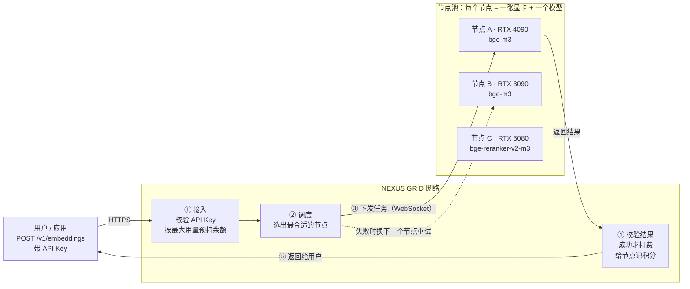
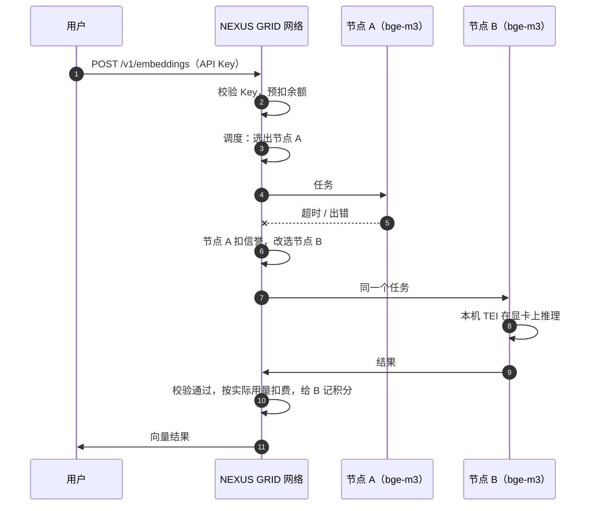
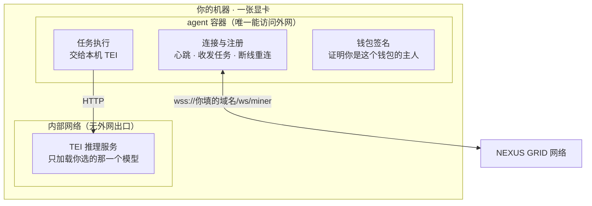

# NEXUS GRID Miner

**中文** | [English](README.en.md)

[](https://github.com/0xRouteAI/nexus-grid-miner/actions/workflows/ci.yml)


## NEXUS GRID 是什么

NEXUS GRID 是一个**开放的去中心化 AI 推理网络**。

- **对开发者**：用一个兼容 OpenAI 的 API 调用开源模型，按调用量付费，**请求失败不收费**。
- **对显卡持有者**：任何人都可以把自己的 NVIDIA 显卡接入网络，成为一个**节点**，为真实请求做推理，每完成一个任务就获得积分。不用审核、不用签约，随时上线、随时下线。

**本仓库就是节点程序**：一个小巧的 Go 程序（agent），加上 Hugging Face 官方的
[text-embeddings-inference](https://github.com/huggingface/text-embeddings-inference)（TEI）推理服务。

**一张显卡只跑一个模型。** 目前可选：

| 模型 | 用途 | 显存 |
|---|---|---|
| [`bge-m3`](https://huggingface.co/BAAI/bge-m3) | 文本向量（embedding），用于搜索、RAG | 8 GB+ |
| [`bge-reranker-v2-m3`](https://huggingface.co/BAAI/bge-reranker-v2-m3) | 重排序（rerank），给检索结果打分排序 | 8 GB+ |

更多模型会陆续上线；网络发布新版本后，节点会自动发现并切换，不需要重新安装。

---

## 架构：一个请求是怎么到达你的显卡的



**① 接入**：网络校验用户的 API Key，按这次请求可能的最大费用先冻结一部分余额。

**② 调度**：在节点池里挑节点，规则是：

1. **先筛选**：只考虑在线、没被封禁、正在提供**这个模型的这个版本**、显存够、手头任务没排满的节点。跑 `bge-m3` 的节点永远收不到重排序请求，反之亦然。
2. **再排序**：手头任务最少的优先 → 信誉分高的优先 → 完成任务多的优先。

**③ 下发任务**：任务通过节点**主动连上来的** WebSocket 发给节点。节点不需要公网 IP，也不用开端口。节点收到后交给本机的 TEI，在显卡上算完把结果送回。

**④ 校验结果**：网络检查结果格式（向量数量、维度、分数范围等）。成功了才按实际用量扣费，多冻结的部分退回给用户，同时给完成任务的节点记积分。

**⑤ 返回**：结果返回给用户。

**失败了怎么办**：节点超时、报错或者返回的结果不合格，网络会**换另一个钱包的节点重试**，一个请求最多尝试 3 次。全部失败就把冻结的余额全额退回，用户不花钱。失败的节点会被扣信誉分，信誉越低越难分到任务。

### 一次请求的时间线



### 节点内部



- **只出不进**：agent 主动连接网络，你的机器不暴露任何端口。
- **推理容器断网**：TEI 只挂在没有外网出口的内部网络上，没法把请求偷偷转发给别的 AI 服务冒充本地计算。网络也会随机抽查结果，作弊的钱包会被整体封禁。
- **钱包只用来签名**：私钥只用于每次连接时签一段注册文字，证明这个钱包是你的；不发交易，钱包里不需要有币。

---

## 跑一个节点

### 准备

- 一张 NVIDIA 显卡：RTX 20 系或更新，8 GB 以上显存。
- NVIDIA 驱动（支持 CUDA 12.2 或更高）和 [NVIDIA Container Toolkit](https://docs.nvidia.com/datacenter/cloud-native/container-toolkit/latest/install-guide.html)。
- Docker 和 Docker Compose v2。
- 一个**专门用于挖矿的**钱包地址和它的私钥。别用存钱的钱包。
- 网络的域名，例如 `nexus.example.com`。

### 1. 下载并配置

```bash
git clone https://github.com/0xRouteAI/nexus-grid-miner.git
cd nexus-grid-miner
cp .env.example .env
```

编辑 `.env`，填这五项（注释请单独写一行，不要写在值后面）：

```dotenv
SERVER_URL=nexus.example.com
WALLET=0x你的钱包地址
MINER_PRIVATE_KEY=你的私钥
COMPOSE_PROFILES=bge-m3
TEI_IMAGE=ghcr.io/huggingface/text-embeddings-inference:89-1.10
```

| 项 | 说明 |
|---|---|
| `SERVER_URL` | 网络域名，只填域名就行 |
| `WALLET` | 积分记到这个地址 |
| `MINER_PRIVATE_KEY` | 只用于注册签名，绝不要提交或外传 |
| `COMPOSE_PROFILES` | **这张卡跑哪个模型，只能填一个**：`bge-m3` 或 `bge-reranker-v2-m3` |
| `TEI_IMAGE` | **必须和显卡匹配**，见下表 |

| 显卡 | `TEI_IMAGE` |
|---|---|
| RTX 20 系 / T4 | `ghcr.io/huggingface/text-embeddings-inference:turing-1.10` |
| RTX 30 系 / A10 / A40 | `ghcr.io/huggingface/text-embeddings-inference:86-1.10` |
| RTX 40 系 / L4 / L40 | `ghcr.io/huggingface/text-embeddings-inference:89-1.10` |
| RTX 50 系 | `ghcr.io/huggingface/text-embeddings-inference:120-1.10` |
| A100 / A30 | `ghcr.io/huggingface/text-embeddings-inference:1.10` |
| H100 | `ghcr.io/huggingface/text-embeddings-inference:hopper-1.10` |

建议再给这个节点起个名字，例如 `NODE_ID=home-4090`。

### 2. 首次下载模型（只需一次）

推理容器正式运行时不能上网，所以先用 bootstrap 配置把模型下载下来：

```bash
docker compose -f docker-compose.yml -f docker-compose.bootstrap.yml up -d
docker compose -f docker-compose.yml -f docker-compose.bootstrap.yml logs -f
docker compose -f docker-compose.yml -f docker-compose.bootstrap.yml down
```

第二条命令会持续输出日志，看到 `Ready` 后按 Ctrl+C，再执行第三条。模型保存在 Docker 卷里，以后不用再下。

### 3. 启动节点

```bash
docker compose up -d --build
docker compose logs -f agent
```

看到 `miner registered with server` 就说明节点上线了，开始接任务。

### 一台机器多张显卡

每张卡单独跑一个节点：把这个目录复制一份，在新目录的 `.env` 里改三项：

```dotenv
GPU_DEVICE=1
NODE_ID=home-gpu1
COMPOSE_PROFILES=bge-reranker-v2-m3
```

- `GPU_DEVICE` 是 `nvidia-smi` 里显卡的编号。
- 每张卡的 `COMPOSE_PROFILES` 可以选不同的模型。
- 钱包可以用同一个，积分都记到这个钱包。
- 模型文件在同一台机器的所有节点之间共享，只下载一次。

### 不用 Docker

也可以编译成单个可执行文件（需要 Go 1.24+），但要自己运行 TEI：

```bash
cd agent-go
go build -trimpath -o bin/nexus-miner-agent ./cmd/agent
SERVER_URL=nexus.example.com WALLET=0x... MINER_PRIVATE_KEY=... MODEL=bge-m3 \
  TEI_URL=http://127.0.0.1:8080 ./bin/nexus-miner-agent
```

跑重排序模型时把 `MODEL` 换成 `bge-reranker-v2-m3`，`TEI_URL` 换成 `RERANK_URL`。
Windows 见 [`RUN_WINDOWS.md`](RUN_WINDOWS.md)。

---

## 节点会自动处理的事

- **断线**：自动重连，1 秒起步，最长间隔 30 秒。
- **模型更新**：定期读取网络的模型目录。网络发布新版本后，节点自动按新版本重新注册，不需要重启。
- **推理服务挂了**：每 30 秒检查一次。TEI 挂了就暂停接单，恢复后自动重新上线。
- **被网络拒绝**：比如版本已下线，节点会刷新目录后重试，不会反复崩溃。
- **随时关机**：`docker compose down` 或直接关机都行。手上没做完的任务会被网络转给别的节点。

---

## 常见问题

| 日志 | 原因 / 解决 |
|---|---|
| `SERVER_URL is required` / `WALLET is required` / `MINER_PRIVATE_KEY is required` | `.env` 里对应的项没填 |
| `Set COMPOSE_PROFILES in .env` / `MODEL is required` | 没选这张卡跑哪个模型 |
| `MODEL must name exactly one model` | 一张卡只能跑一个模型，`COMPOSE_PROFILES` 只填一个 |
| `Set TEI_IMAGE in .env for your GPU` | 没填 `TEI_IMAGE`，按上表选 |
| 推理容器日志里出现 `compute cap` / `CUDA` 报错 | `TEI_IMAGE` 和显卡不匹配，或驱动太旧 |
| `MINER_PRIVATE_KEY belongs to ..., not WALLET ...` | 私钥和钱包地址不是同一个账户 |
| `connection refused` / 超时 | `SERVER_URL` 写错、防火墙拦截，或代理不支持 WebSocket |
| `no servable model yet; retrying` | TEI 还在加载模型；等它显示 `Ready` |
| `model identity check failed` | TEI 加载的模型和网络要求的不一致 |
| 签名错误 | 本机时间偏差超过 5 分钟，请开启自动对时 |
| `Unknown GPU` | 没装 NVIDIA Container Toolkit，或在 `.env` 里手动填 `GPU_MODEL` / `VRAM_MB` |
| `wallet is banned` | 审计不通过或连续失败，请联系网络运营方申诉 |

全部接口、配置项和自动行为见 [`docs/INTERFACES.md`](docs/INTERFACES.md)。

---

## 开发

```bash
cd agent-go
go vet ./...
go test -race ./...
```

| 路径 | 职责 |
|---|---|
| `agent-go/cmd/agent` | 入口：连接、退避重连；supervisor 维护当前可服务的模型，目录或健康状态变化时重新注册 |
| `agent-go/internal/wsclient` | WebSocket 会话：注册、心跳、并发执行任务、断线时取消在途任务 |
| `agent-go/internal/engine` | 把任务交给本机 TEI，启动时核对 TEI 加载的模型 |
| `agent-go/internal/catalogclient` | 读取网络的模型目录，决定这张卡能跑哪个版本 |
| `agent-go/internal/signing` | 钱包签名（EIP-191） |
| `agent-go/internal/gpu` | 识别显卡型号和显存 |
| `agent-go/internal/protocol` | 与网络之间的消息格式 |
| `agent-go/internal/teitest` | 测试用的 TEI 替身 |

欢迎提 Issue 和 PR。修改通信格式前请先读 [`docs/INTERFACES.md`](docs/INTERFACES.md) 第 F 节。
**不要在 Issue、日志或提交里贴私钥和 `.env` 文件。**

## 安全

发现安全问题请私下联系维护者，不要直接公开提 Issue。

## 许可证

[MIT](LICENSE)
